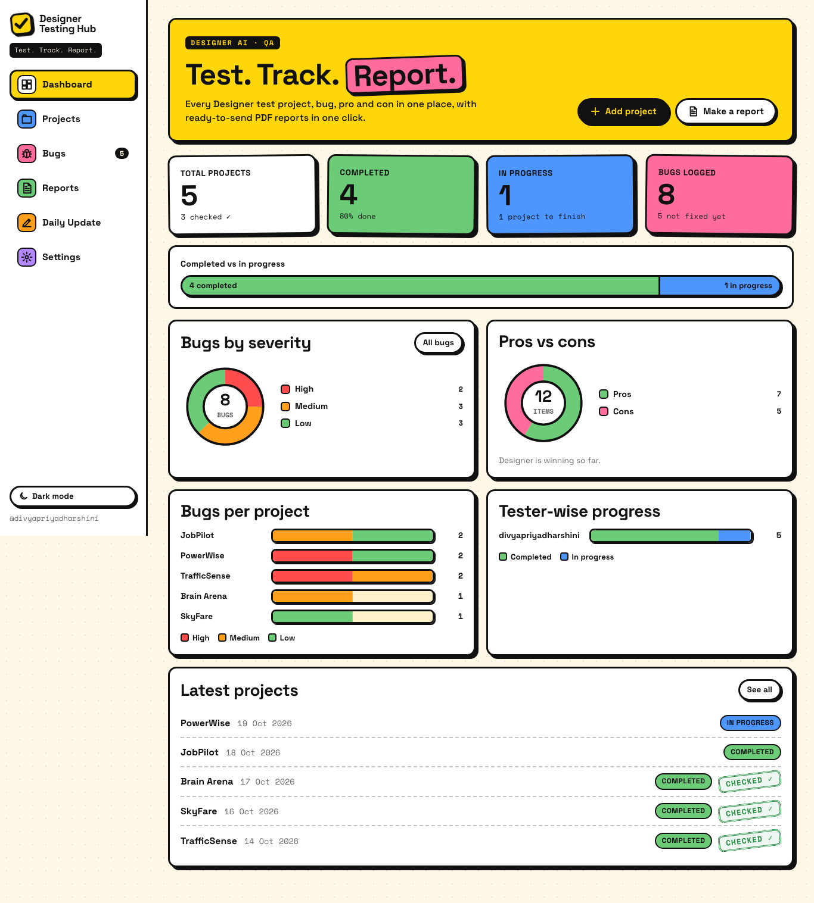
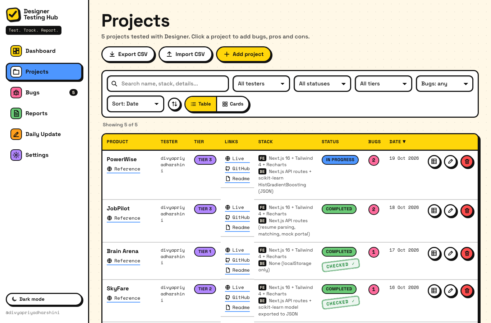
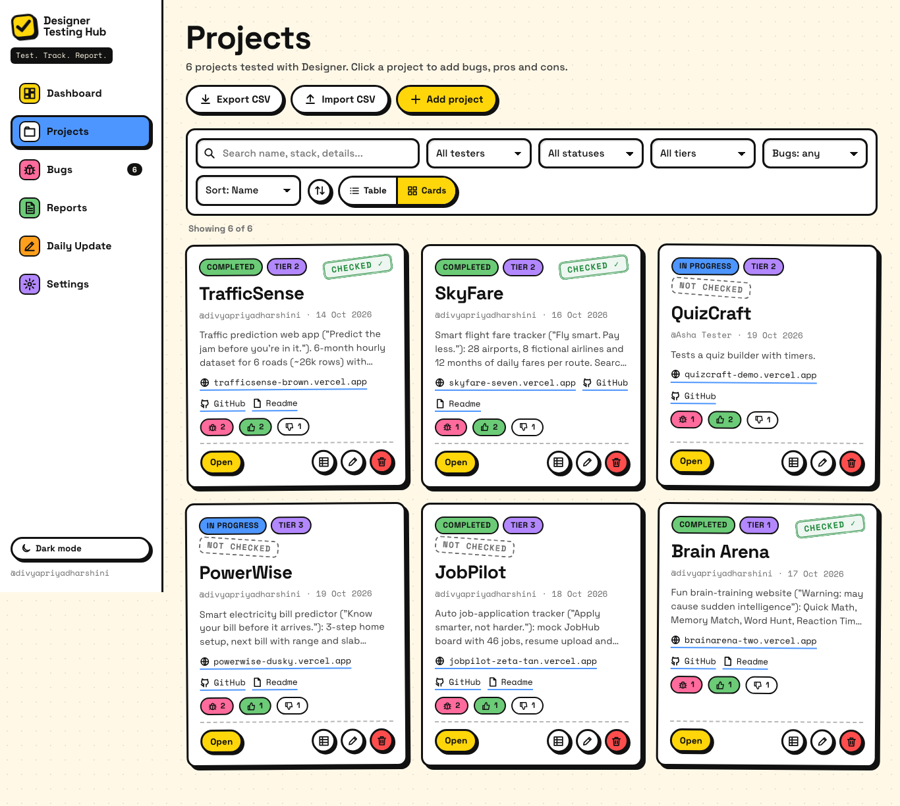
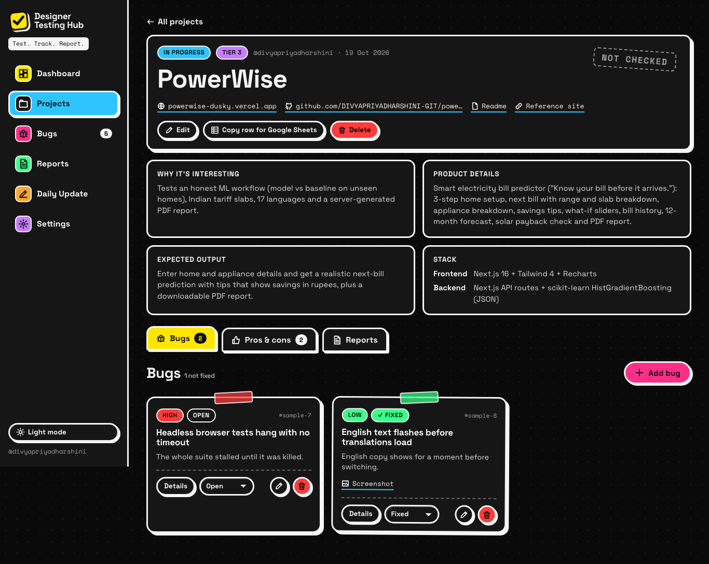
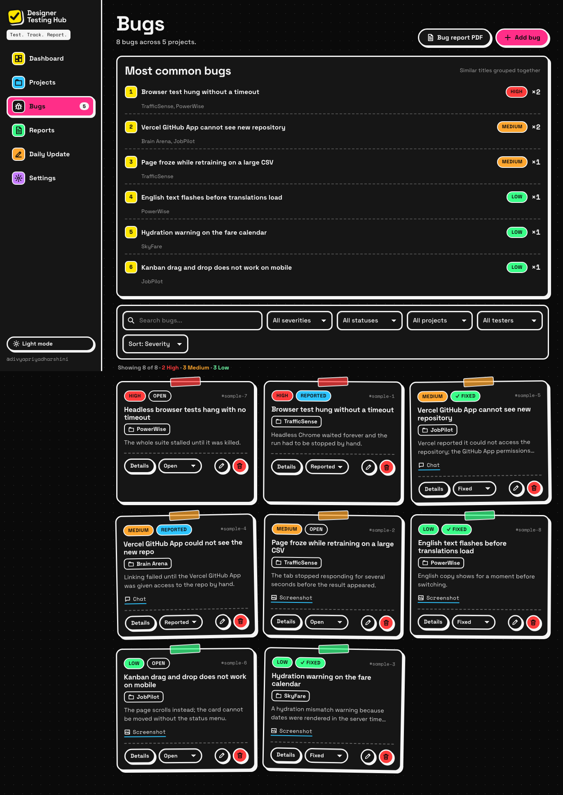
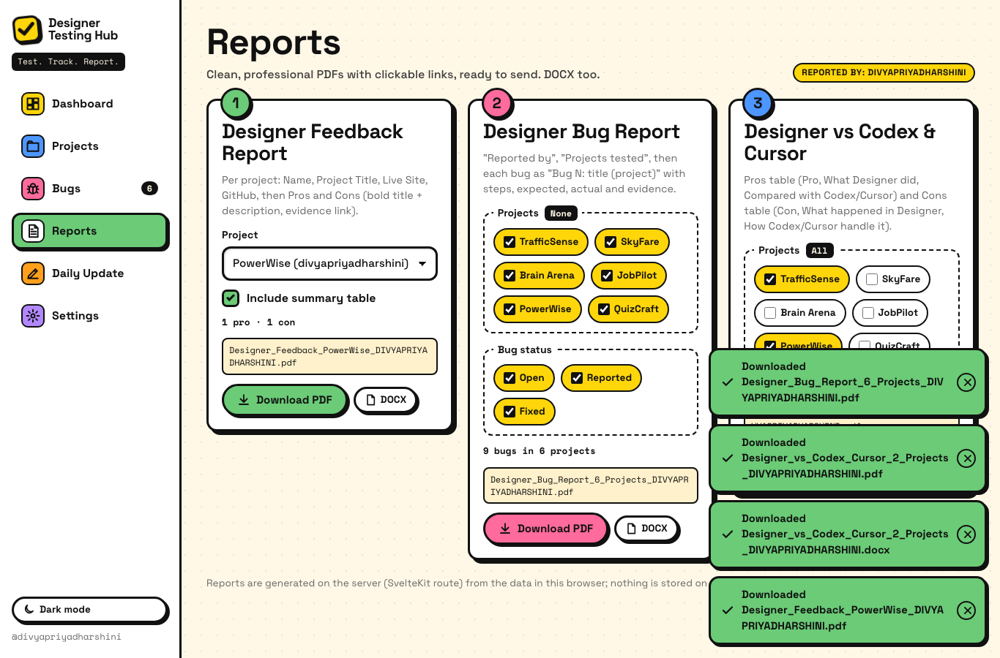
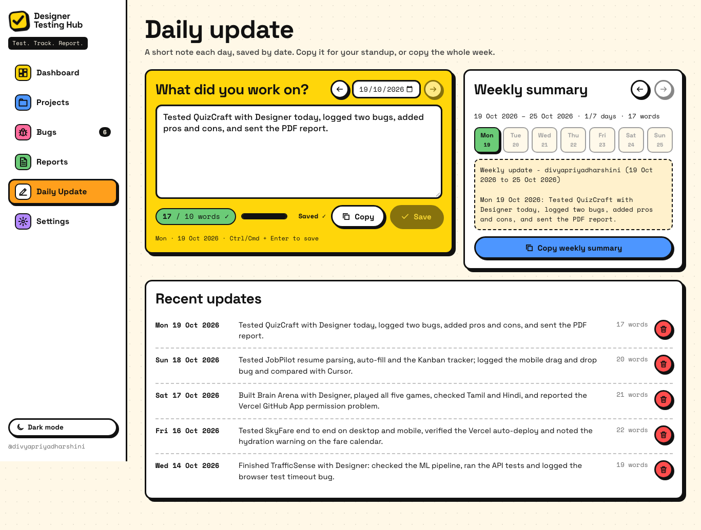
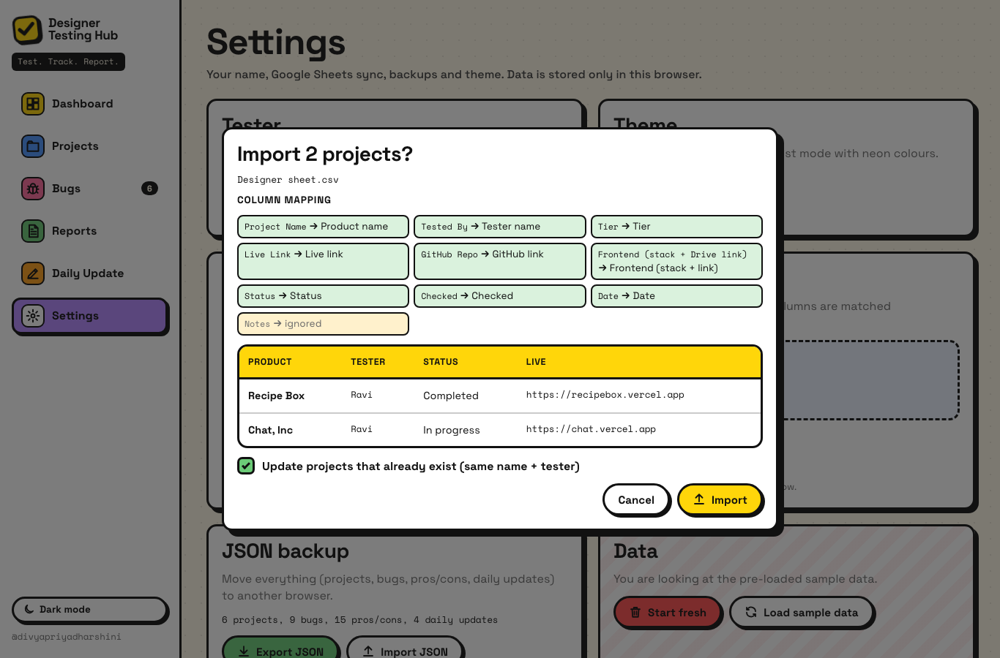
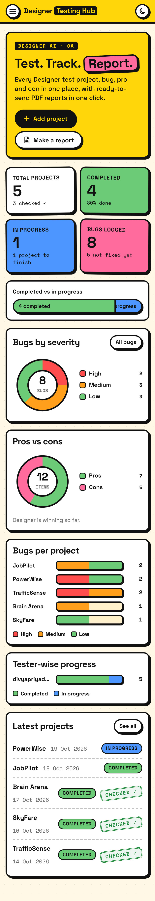

# Designer Testing Hub

> **Test. Track. Report.**

An internal tool for the team that tests the **Designer AI app** by building real projects with it. It replaces the shared Google Sheet and the hand-made Word/PDF reports. Testers record each project, its links, bugs, pros and cons, and get a **ready-to-send PDF report in one click**.



## 🌐 Live demo

- **Live site:** https://designer-testing-hub.vercel.app
- **GitHub:** https://github.com/DIVYAPRIYADHARSHINI-GIT/designer-testing-hub

Try it: [Dashboard](https://designer-testing-hub.vercel.app) · [Projects](https://designer-testing-hub.vercel.app/projects) · [PowerWise project](https://designer-testing-hub.vercel.app/projects/p-powerwise) · [Bugs](https://designer-testing-hub.vercel.app/bugs) · [Reports](https://designer-testing-hub.vercel.app/reports) · [Daily update](https://designer-testing-hub.vercel.app/daily) · [Settings / Sheet sync](https://designer-testing-hub.vercel.app/settings)

The full 165-check browser test passes against the live site (desktop, mobile, dark mode; every PDF/DOCX report downloaded and checked for clickable links).

The app ships with sample data (5 projects by tester `divyapriyadharshini`). Use **Settings → Start fresh** to clear it.

## Features

| Area | What you get |
| --- | --- |
| **Projects** | Table **and** card view with every column from the team sheet: Product name, Reference website link, Tester name, Tier, Why it's interesting, Product details, Expected output, Frontend (stack + Drive link), Backend (stack + Drive link), Readme link, GitHub link, Live link, Status (In progress / Completed), Checked (Yes/No), Date. Add / edit / delete in a clean form with **link validation** (`github.com/x` becomes `https://github.com/x`), clickable links, **search**, **filters** (tester, status, tier, has bugs) and **sort** (date, name, tester, tier, status, bug count). |
| **Bugs** | Per project: title, steps, expected, actual, severity (High / Medium / Low), screenshot link, video link, chat link and status (Open / Reported / Fixed). Shown as **sticker cards** with severity colour tags; status can be changed inline. The **Bugs page** lists every bug across projects with filters (severity, status, project, tester, search), sorting and a **"Most common bugs"** summary that groups similar titles (e.g. *"Browser test hung without a timeout"* + *"Headless browser tests hang with no timeout"* → ×2). |
| **Pros & cons** | Per project: title, description, optional evidence links (chat, screenshot/video) and an optional **"Compared with Codex / Cursor"** note. |
| **One-click reports** | **1. Designer Feedback Report** (per project): Name, Project Title, Live Site, GitHub, then Pros and Cons (bold title + description + evidence link), with an option to include or hide a summary table. **2. Designer Bug Report** (one or many projects, filter by bug status): Reported by, Projects tested, then *"Bug N: title (project)"* with Steps, Expected, Actual and evidence links. **3. Designer vs Codex & Cursor**: a Pros table (Pro / What Designer did / Compared with Codex/Cursor) and a Cons table (Con / What happened in Designer / How Codex/Cursor handle it). All three come as **PDF and DOCX**, with **clickable links** and file names such as `Designer_Feedback_PowerWise_DIVYAPRIYADHARSHINI.pdf`. The PDFs are clean and professional (A4, Helvetica, page numbers, repeating table headers, no brutalist styling). |
| **Daily update** | A "What did you work on?" box with a **live word counter** (minimum 10 words), saved by date (move between days with the arrows or the date picker), one-click **Copy**, a **weekly summary** (Mon to Sun) with its own copy button, and a list of recent updates. |
| **Sheet sync** | **Import CSV** exported from Google Sheets. Columns are **mapped automatically by header name** (e.g. "Project Name", "Tested By", "GitHub Repo", "Frontend Drive Link"), with a preview before importing. Re-importing updates existing projects (same name + tester) instead of duplicating them. **Export CSV** uses the sheet's column order. **"Copy row for Google Sheets"** copies a project as tab-separated text that pastes straight into a sheet row. |
| **Dashboard** | Total projects, completed vs in progress, bugs by severity, bugs per project (stacked by severity), pros vs cons, and tester-wise progress, all as simple SVG charts. |
| **Data** | Everything is stored in **localStorage**. **JSON backup export/import** moves data between browsers. No database, no accounts, no API keys. |
| **Design** | Neo-brutalist: thick black borders, hard offset shadows, flat yellow `#FFD60A` / pink `#FF6B9D` / blue `#4D96FF` / green `#6BCB77` on off-white, chunky rounded buttons that press down, **Space Grotesk** headings and **Space Mono** for links and IDs. Sticker-style bug cards, a "Checked ✓" rubber-stamp badge, playful hover wobble. Sidebar navigation with custom SVG icons, fully responsive (slide-out menu on mobile), a **dark brutalist mode** (black background, neon colours), loading and empty states, and confirmation dialogs before every delete. |

## Screenshots

| | |
| --- | --- |
|  |  |
|  |  |
|  |  |
|  |  |

Sample generated reports: [feedback PDF](docs/sample-reports/Designer_Feedback_PowerWise_DIVYAPRIYADHARSHINI.pdf) · [bug report PDF](docs/sample-reports/Designer_Bug_Report_5_Projects_DIVYAPRIYADHARSHINI.pdf) · [comparative PDF](docs/sample-reports/Designer_vs_Codex_Cursor_5_Projects_DIVYAPRIYADHARSHINI.pdf) · [feedback DOCX](docs/sample-reports/Designer_Feedback_PowerWise_DIVYAPRIYADHARSHINI.docx)

## Tech stack

- **SvelteKit 2 + Svelte 5 (runes) + TypeScript**, built with Vite 7
- **@sveltejs/adapter-vercel**. Pages are client-rendered (all data lives in localStorage); the **server routes** run as Vercel Node.js functions:
  - `POST /api/report`: PDF or DOCX (feedback / bugs / compare)
  - `POST /api/csv/import`: CSV text → mapped project drafts
  - `POST /api/csv/export`: projects → CSV attachment
  - `GET /api/health`
- **Dependency-free generators** in `src/lib/report/`: a small PDF writer (Helvetica core fonts with real AFM widths for accurate wrapping, `/URI` link annotations, tables, page breaks) and a DOCX writer (WordprocessingML + external hyperlinks in a ZIP). Both render the same format-neutral report model, so PDF and DOCX always match. If the server can't be reached, the browser builds the same file itself.
- **Charts:** plain SVG components (`src/lib/components/charts/`), no chart library
- **Fonts:** `@fontsource/space-grotesk`, `@fontsource/space-mono` (self-hosted)
- No database, no auth, no API keys. Runtime dependencies: none (everything is bundled)

```
src/
  lib/
    types.ts          data model (mirrors the sheet columns)
    store.svelte.ts   localStorage store (explicit saves, no autosave effects)
    csv.ts            CSV parse/serialize, header auto-mapping, TSV row copy
    group.ts          "most common bugs" title grouping
    daily.ts          word minimum + weekly summary
    data.ts           sample data + backup validation
    report/           build.ts (report content) · pdf.ts · docx.ts · validate.ts
    components/       Sidebar, forms, BugCard, FeedbackCard, Modal, charts, Icon (custom SVG)
  routes/
    +page.svelte      Dashboard
    projects/         list (table/cards) + [id] detail (bugs, pros & cons, reports)
    bugs/  reports/  daily/  settings/
    api/              report, csv/import, csv/export, health
tests/
  unit/               node:test suites (CSV, reports, grouping, daily, data)
  e2e/                headless Chrome (DevTools protocol, no npm deps) full-flow test
  tools/pdfcheck.js   macOS PDFKit check: page count, link annotations, page PNGs
```

## Setup

Requirements: **Node.js 22.12+** (tested on Node 26) and npm.

```bash
cd testing-hub
npm install
npm run dev          # http://localhost:5173
```

Other scripts:

```bash
npm run check        # svelte-check (types + Svelte diagnostics)
npm test             # unit tests (node:test, runs the TypeScript directly)
npm run build        # production build (Vercel adapter output in .vercel/output)
npx vite preview --port 4317 --strictPort &
caffeinate -dims env BASE_URL=http://localhost:4317 node tests/e2e/smoke.mjs   # full browser test
osascript -l JavaScript tests/tools/pdfcheck.js "$PWD/file.pdf" "$PWD/out"     # macOS: inspect a PDF
```

The e2e test drives the locally installed Google Chrome headless with short timeouts, a freeze heartbeat and a global watchdog. It covers: add project → validation → bugs (add/edit/status/delete with confirmation) → pros and cons → every PDF/DOCX report (downloaded and checked for clickable links) → bugs page filters and most common bugs → search/filter/sort/card view → copy row (TSV) → CSV export + import (auto mapping, re-import without duplicates) → daily update (counter, save by date, copy, weekly summary) → JSON backup → start fresh and empty states → theme. It then checks every page on desktop, mobile, dark and mobile-dark (no console errors, no horizontal overflow, no freezes).

## Using it with the Google Sheet

1. In Google Sheets: **File → Download → Comma-separated values (.csv)**.
2. In the hub: **Settings → Google Sheets sync → drop the CSV**. Check the column mapping preview, then **Import**.
3. To send a project back: open it and click **Copy row for Google Sheets**, then click the first cell of an empty row in the sheet and paste. Or use **Export CSV** for everything.

Frontend/Backend cells use `stack | Drive link` (e.g. `React + Tailwind | https://drive.google.com/...`); on import, any link in the cell is split out automatically. Dates accept `YYYY-MM-DD`, `DD/MM/YYYY`, `19 Oct 2026` and `Oct 19, 2026`.

## Deploying

Deployed on **Vercel (Hobby)** with the SvelteKit Vercel adapter and linked to this GitHub repo, so every push to `main` deploys to production automatically. No environment variables are needed.

## License

MIT
